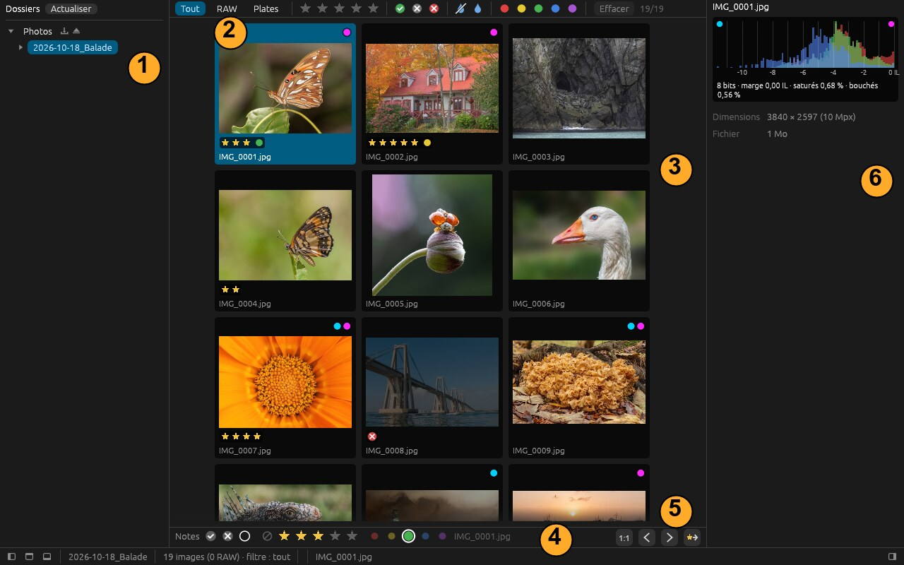
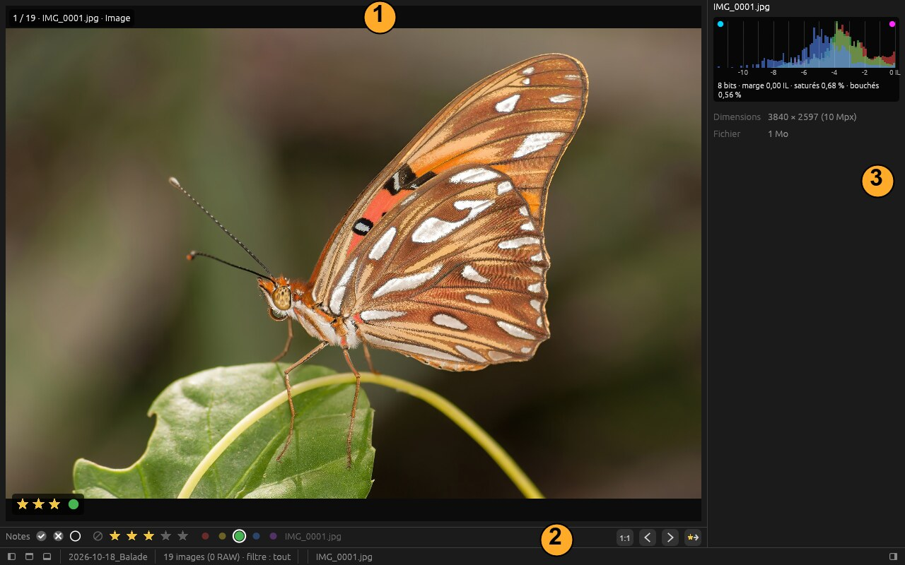
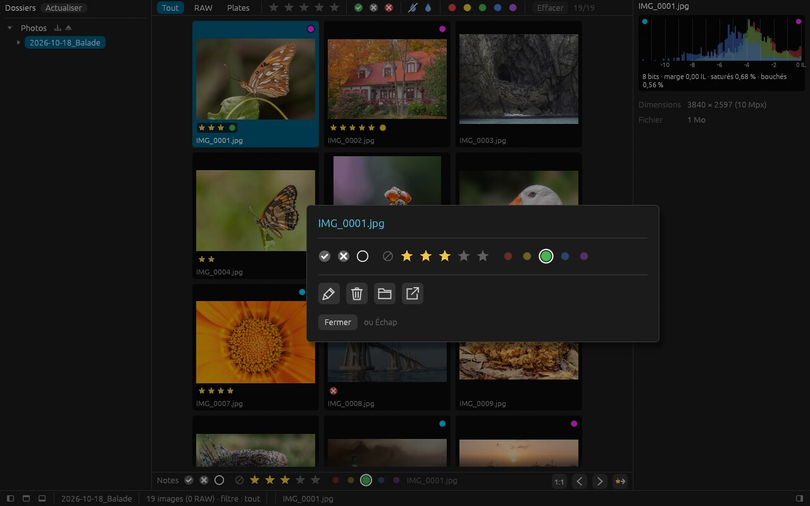
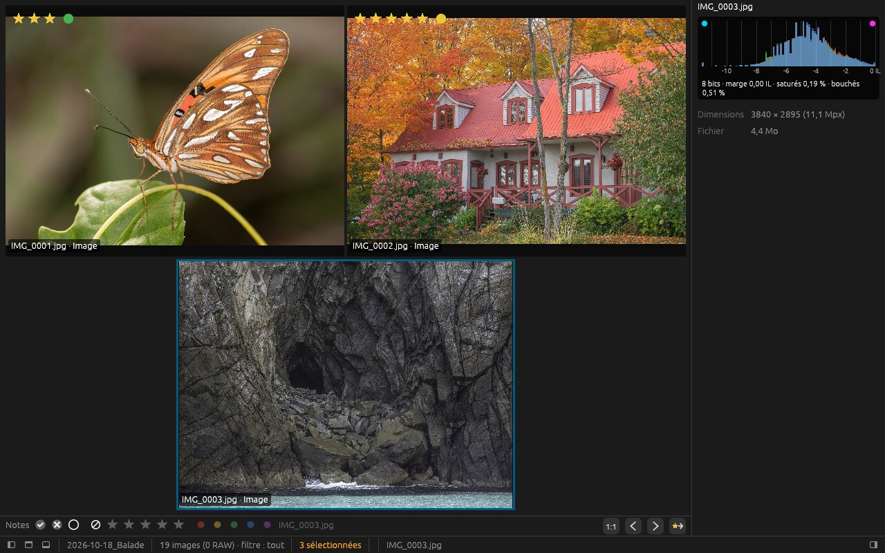
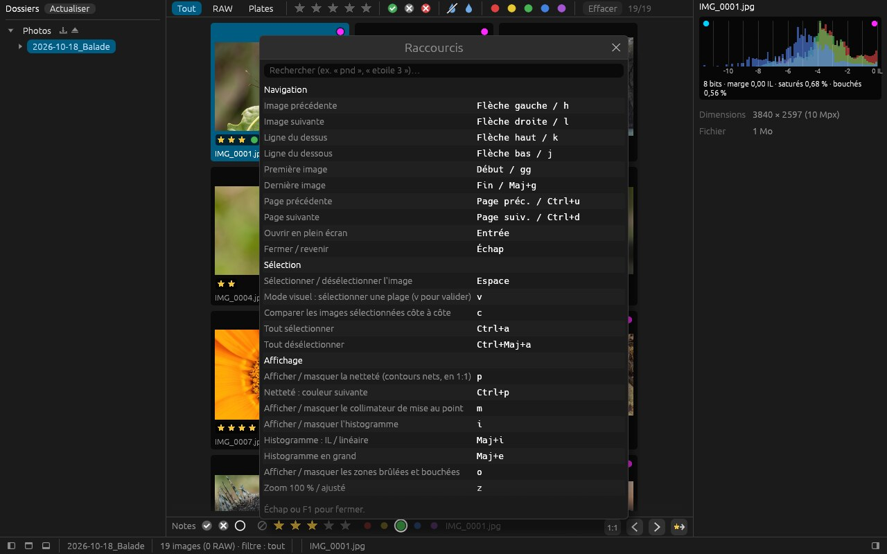

# tri — premiers pas

*[English version](../en/manual.md)*

`tri` sert à trier une séance photo : parcourir les images, les noter, garder les bonnes.
Ce petit guide montre où sont les choses ; pour le reste, **c'est à vous de chercher** —
c'est justement ce qui nous intéresse : savoir ce qui se trouve tout seul, et ce qui ne se
trouve pas.

> **Avant de commencer** : travaillez sur une **copie** de vos photos. Les notes sont
> écrites dans des petits fichiers `.xmp` à côté des images (lus aussi par darktable,
> digiKam, Lightroom…), et renommer ou supprimer agit sur les vrais fichiers.

Compilation et installation : voir [build.md](build.md). Lancement : `tri-gui`, ou
`tri-gui <dossier>` pour ouvrir directement un dossier.

## L'écran principal

1. **Dossiers** : vos disques et cartes mémoire (une carte branchée apparaît d'elle-même).
2. **Filtres** : type de fichier, étoiles, drapeaux, netteté, couleurs.
3. **Vignettes** : un clic sélectionne, un double-clic (ou Entrée) ouvre en grand.
4. **Notes** de l'image sélectionnée : drapeau, étoiles, couleur.
5. **1:1**, image précédente / suivante, et un dernier bouton à découvrir.
6. **Histogramme** et informations de prise de vue.

## En grand

1. Ce qui est affiché (et l'image en cours).
2. Les mêmes boutons qu'en grille.
3. L'histogramme suit l'image affichée.

Échap revient à la grille.

## Noter

Au clavier : **0 à 5** pour les étoiles, **6 à 9** pour les couleurs, **Maj+P** / **Maj+X**
pour accepter / rejeter. À la souris : le bandeau du bas, ou un **clic droit** sur une
image :

## Et encore…

Plusieurs images côte à côte, c'est possible :

Comment ? **F1** affiche tous les raccourcis, avec une recherche :

## Vos retours

Ce qui nous aide le plus :

- ce que vous avez **cherché sans le trouver** (et où vous l'avez cherché) ;
- ce qui vous a **surpris** ou semblé illogique ;
- ce qui vous a **manqué** par rapport à vos outils habituels.

Captures d'écran bienvenues. Merci !

---

Photos des captures : Wikimedia Commons, domaine public / CC0
([crédits](../manual-images/CREDITS.md)).
