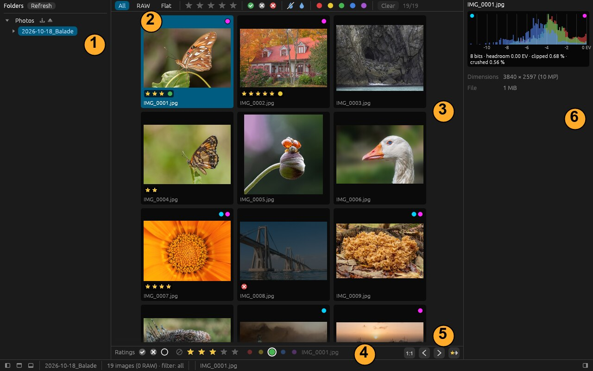
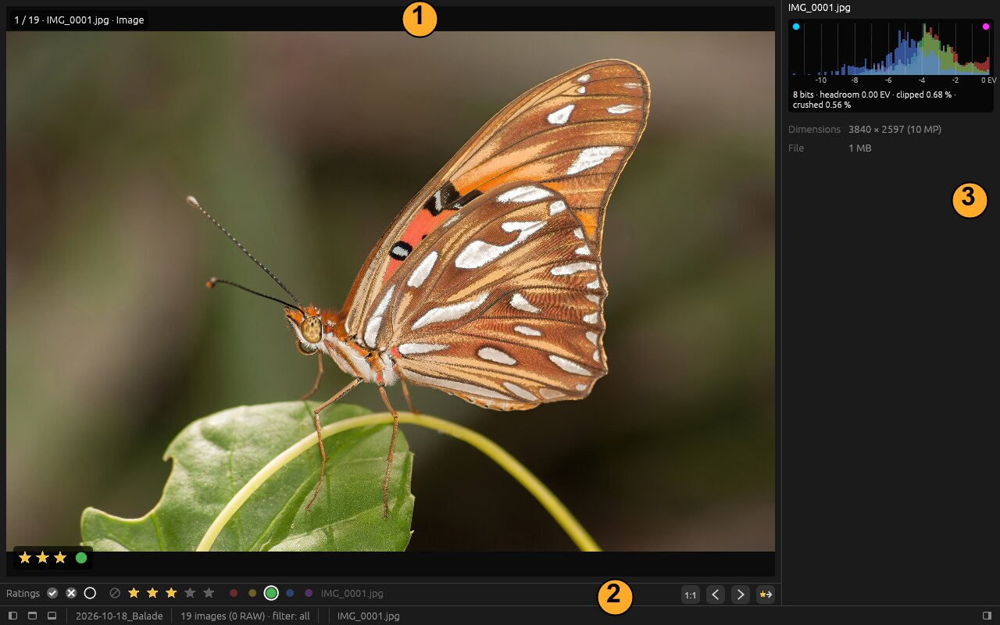
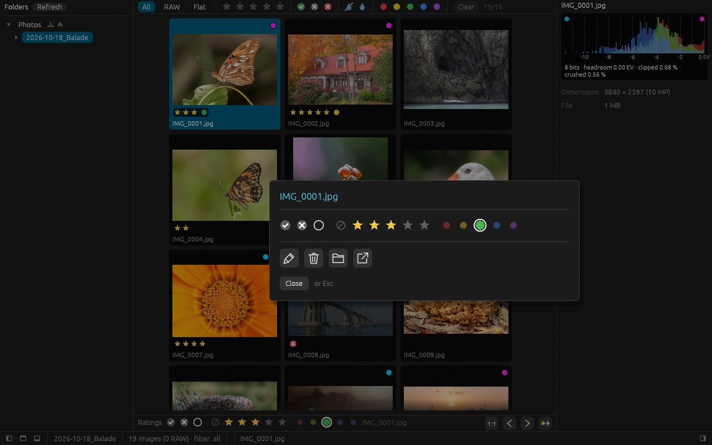
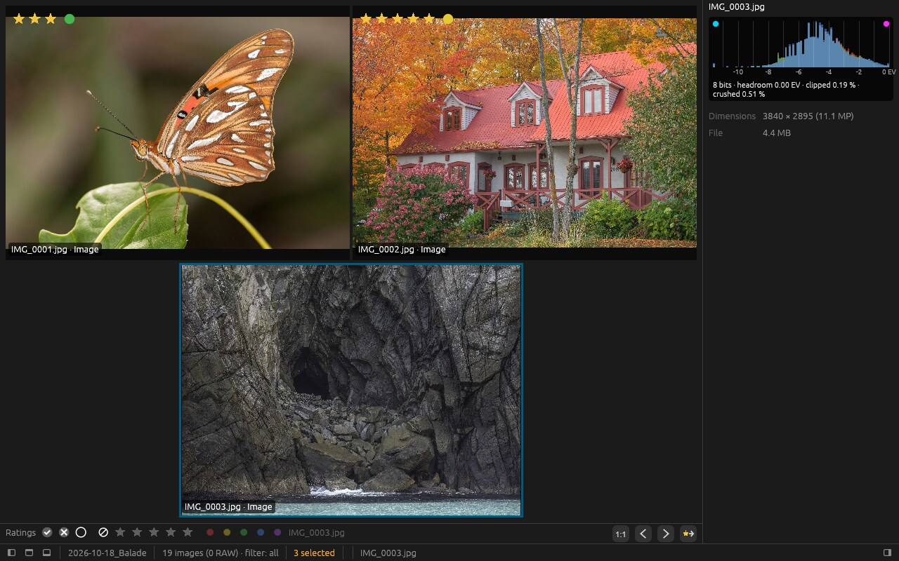
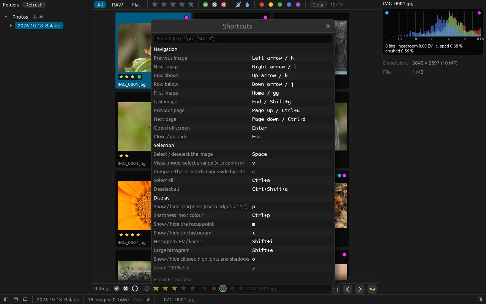

# tri — getting started

*[Version française](manuel.md)*

`tri` is for culling a photo shoot: browse the images, rate them, keep the good ones.
This short guide shows where things are; for the rest, **it is up to you to explore** —
that is exactly what we want to learn: what you find on your own, and what you don't.

> **Before you start**: work on a **copy** of your photos. Ratings are written to small
> `.xmp` files next to the images (also read by darktable, digiKam, Lightroom…), and
> renaming or deleting acts on the real files.

Building and installing: see [build.md](build.md) (in French). To launch: `tri-gui`, or
`tri-gui <folder>` to open a folder directly. The interface follows the system language
(French or English); `[i18n] language = "en"` in the configuration file forces English.

## The main screen

1. **Folders**: your drives and memory cards (a card shows up by itself when plugged in).
2. **Filters**: file type, stars, flags, sharpness, labels.
3. **Thumbnails**: a click selects, a double-click (or Enter) opens full screen.
4. **Ratings** of the selected image: flag, stars, colour label.
5. **1:1**, previous / next image, and one last button to discover.
6. **Histogram** and shooting information.

## Full screen

1. What is shown (and the current image).
2. The same buttons as in the grid.
3. The histogram follows the displayed image.

Esc goes back to the grid.

## Rating

With the keyboard: **0 to 5** for stars, **6 to 9** for colour labels, **Shift+P** /
**Shift+X** to pick / reject. With the mouse: the bar at the bottom, or a **right click**
on an image:

## And more…

Several images side by side? Possible:

How? **F1** lists every shortcut, with a search box:

## Your feedback

What helps us most:

- what you **looked for and didn't find** (and where you looked);
- what **surprised** you or felt illogical;
- what you **missed** compared with your usual tools.

Screenshots welcome. Thank you!

---

Photos in the screenshots: Wikimedia Commons, public domain / CC0
([credits](manual-images/CREDITS.md)).
